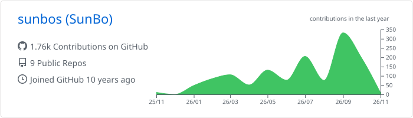
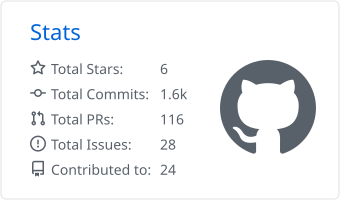
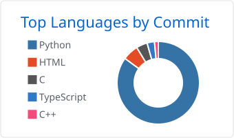
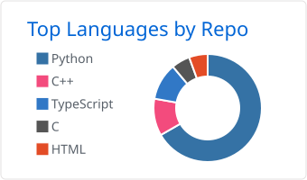
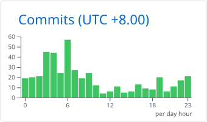

# SunBo

<picture>
  <source media="(prefers-color-scheme: dark)" srcset="./assets/profile/banner-dark.svg?v=3">
  <source media="(prefers-color-scheme: light)" srcset="./assets/profile/banner-light.svg?v=3">
  
</picture>

**让模型接入工具，让执行结果可验证。**

我用 Python 构建数据工具与稳定性测试系统，关注 **AI 应用与 Harness 工程**中的上下文、工具接口、反馈验证和异常恢复。维护开源项目 **sqlseed**，并在设备测试实践中探索模型分析与确定性执行的协作。

`Python` · `LLM APIs` · `MCP` · `pytest`

[sqlseed](https://github.com/sunbos/sqlseed) · [稳定性测试实践](#稳定性测试-harness--执行诊断与验证) · [能力与证据](#能力与证据) · [开源协作](#开源协作)

## 项目与实践

### sqlseed · 数据生成引擎与 AI 工作台

**作者 / 维护者** · `SQLite / PostgreSQL` · `AI / MCP`

为 SQLite / PostgreSQL 开发与测试场景生成可重复的数据。核心引擎离线运行，AI 作为可选的配置生成与修复能力；用户可先检查规则与样例，再确认写入。

[项目源码](https://github.com/sunbos/sqlseed) · [快速开始](https://github.com/sunbos/sqlseed/blob/main/README.zh-CN.md#快速开始) · [工作台指南](https://sunbos.github.io/sqlseed/web-workbench/)

> **流程示意**：数据库结构与字段规则 → 配置校验、依赖检查和样例预览 → 生成并写入关联数据。

查看真实工作台截图与 AI / MCP 工程实现

[系统架构](https://github.com/sunbos/sqlseed/blob/main/docs/architecture.md) · [AI 实现](https://github.com/sunbos/sqlseed/tree/main/plugins/sqlseed-ai) · [Core MCP](https://github.com/sunbos/sqlseed/tree/main/plugins/mcp-server-sqlseed) · [AI MCP](https://github.com/sunbos/sqlseed/blob/main/plugins/sqlseed-ai/src/sqlseed_ai/mcp.py) · [订单示例](https://github.com/sunbos/sqlseed/tree/main/examples/order_workflow)

<picture>
  <source media="(prefers-color-scheme: dark)" srcset="https://raw.githubusercontent.com/sunbos/sqlseed/2c14563364f2e3a34038e14a0d2b37cabd0a2705/docs/assets/screenshots/web-workbench-zh-CN-dark.png">
  <source media="(prefers-color-scheme: light)" srcset="https://raw.githubusercontent.com/sunbos/sqlseed/2c14563364f2e3a34038e14a0d2b37cabd0a2705/docs/assets/screenshots/web-workbench-zh-CN-light.png">
  
</picture>

实际工作台截图，使用虚构订单数据；可交互体验请按上方快速开始与工作台指南在本地运行。

<!-- profile-ai:sqlseed-main:start -->
主分支已实现：

- **给模型提供数据库上下文**：整理 schema、索引、外键、数据样本及分布信息，生成可复用的数据规则。
- **验证与反馈修正**：配置经过结构校验、列名核对和少量样本预览；把错误摘要反馈给模型，在限定重试次数内修正配置。
- **通过 MCP 接入 AI 助手**：Core MCP 提供规则式 YAML 生成与单表填充；独立的 AI MCP 提供模型辅助配置生成、表分析与分析后填充。
- **处理实际的数据约束**：表依赖拓扑排序、循环依赖检测、外键关联和固定 seed，让配置能接入可复现的数据生成流程。
<!-- profile-ai:sqlseed-main:end -->

#### 契约驱动修复与交互式工作台

<!-- profile-ai:sqlseed-workbench:start -->
**[工作台 PR #10](https://github.com/sunbos/sqlseed/pull/10) 已合入 main。** 将字段规则调整、预览、生成、运行记录和候选包交付串成完整流程：

- **分层修复配置**：先做契约检查与确定性规则修复，再按错误类型缩小上下文、分级调用模型修复；遇到重复违规、重试或时间预算耗尽时停止或降级。[修复编排](https://github.com/sunbos/sqlseed/blob/01b1584152aa1fc9f1135ea6add6fb1ab8c303be/plugins/sqlseed-ai/src/sqlseed_ai/auto_heal/orchestrator.py#L2953)
- **审阅后应用 AI 建议**：把建议约束到选定字段与生成器参数，校验依赖并生成只读样例，以规则差异供人审阅后应用。[建议校验](https://github.com/sunbos/sqlseed/blob/01b1584152aa1fc9f1135ea6add6fb1ab8c303be/plugins/sqlseed-web/src/sqlseed_web/workbench_ai.py#L735)
- **让执行结果可追溯**：绑定数据库身份、schema、配置版本与检查结果，保存运行快照并区分计划量和实际提交量；部分失败后，仅在计数明确时生成剩余数据计划。[运行记录](https://github.com/sunbos/sqlseed/blob/01b1584152aa1fc9f1135ea6add6fb1ab8c303be/plugins/sqlseed-web/src/sqlseed_web/workbench_runtime.py#L790)
<!-- profile-ai:sqlseed-workbench:end -->

#### GemmaSQLSeed · sqlseed 的 AI Agent 参赛实践

**2026.06 · GDG 上海 Gemma 4 开发者大赛 · AI Agent 赛道**

围绕自然语言需求、SQLite schema 理解、配置生成和反馈修正，提交 GemmaSQLSeed 参赛作品与技术报告。作品与 sqlseed 共用技术基础，重点呈现模型如何参与数据生成工作流。

参赛材料通过两次 PR 合并收录，可查看问题定义、工具设计与技术方案：

[作品与技术报告](https://github.com/gdgshanghai/Gemma4-Hackathon-ShangHai/tree/main/submissions/2026/track_A/GemmaSQLSeed) · [首次提交 #19](https://github.com/gdgshanghai/Gemma4-Hackathon-ShangHai/pull/19) · [后续完善 #39](https://github.com/gdgshanghai/Gemma4-Hackathon-ShangHai/pull/39)

### 稳定性测试 Harness · 执行、诊断与验证

**工程实践 · 非开源案例（脱敏）**

将设备稳定性测试组织为可配置的动作与检查项，统一异常处理、环境恢复和诊断记录。通过 LangGraph 表达执行流程，模型辅助归因，程序依据采集事实判定结果。

> **异常处理示意**：执行与采集 → 规则判定 → 环境恢复与辅助分析 → 结果和诊断记录。

查看模型边界、恢复机制与验证方式

- **模型建议与测试判定分工**：LLM 提供结构化故障诊断和风险注解，通过／失败仍由规则和采集事实决定；模型不可用时回退规则诊断。
- **工具与恢复边界**：区分测试、诊断与环境恢复的职责，限制工具的适用阶段，并保留恢复动作记录。
- **诊断经验可追溯**：可按场景归档诊断，并将历史摘要用于后续风险先验，同时限制先验的影响范围。
- **离线验证**：通过 FakeClient 和图执行测试检查流程、能力依赖、诊断降级及模型不翻转规则判定的通过／失败结果这一边界。

更多项目实践：Python SDK 与设备事件校验

### ezviz-openapi-utils · Python SDK 与设备 API 集成

**作者 / 维护者** · [项目](https://github.com/sunbos/ezviz-openapi-utils) · [中文文档](https://github.com/sunbos/ezviz-openapi-utils/blob/main/README.zh-CN.md) · [PyPI](https://pypi.org/project/ezviz-openapi-utils/)

将萤石开放平台的认证客户端与设备 API 分层封装，便于 Python 工作流集成设备接口。提供双语文档与测试用例，并以 Python 包发布。

- **接口与错误处理**：认证客户端负责令牌与请求会话，API 层封装设备操作，以自定义异常表达认证失败、API 错误与设备能力限制。[认证客户端](https://github.com/sunbos/ezviz-openapi-utils/blob/25cd41321d244592b4f5c9250b13443e5502129d/src/ezviz_openapi_utils/client.py#L20) · [API 实现](https://github.com/sunbos/ezviz-openapi-utils/blob/25cd41321d244592b4f5c9250b13443e5502129d/src/ezviz_openapi_utils/api.py#L67)
- **类型与验证入口**：为令牌响应定义 TypedDict，提供认证相关测试用例；真实接口测试需要配置凭据。[令牌响应类型](https://github.com/sunbos/ezviz-openapi-utils/blob/25cd41321d244592b4f5c9250b13443e5502129d/src/ezviz_openapi_utils/oauth.py#L29) · [测试用例](https://github.com/sunbos/ezviz-openapi-utils/blob/25cd41321d244592b4f5c9250b13443e5502129d/tests/test_client.py#L31)

### 多协议设备事件校验 · Python 与 Dify Workflow

**工程实践 · 非开源案例（脱敏）**

将 Python／pytest 与 Dify Workflow 用于多协议设备事件测试，串联环境准备、测试数据构造、动作触发和事件校验。

> **流程示意**：一项设备事件测试 → 触发操作、采集事件、程序与模型分层校验 → 回填结果和问题说明。

- **分层校验**：程序处理事件采集、能力预检和基础核对，模型参与复杂事件内容分析。
- **工作流工具化**：将准备环境、构造测试数据和触发操作拆成可组合的工作流，提供统一的 Python 调用入口。
- **运行约束**：处理查询限流、超时、设备能力差异，并将判定结果写回统一记录。

## 能力与证据

- **上下文与工具接口**：从数据库 schema 组织模型上下文，通过 MCP 暴露可调用能力。[sqlseed AI](https://github.com/sunbos/sqlseed/tree/main/plugins/sqlseed-ai) · [MCP 实现](https://github.com/sunbos/sqlseed/tree/main/plugins/mcp-server-sqlseed)
- **执行验证与反馈**：校验模型输出，处理重试预算、运行快照与失败恢复。[系统架构](https://sunbos.github.io/sqlseed/architecture/) · [测试与 CI](https://github.com/sunbos/sqlseed/actions/workflows/ci.yml)
- **Python API / SDK 工程**：分层封装认证与业务接口，维护类型、错误语义及同步／异步调用。[EZVIZ SDK](https://github.com/sunbos/ezviz-openapi-utils) · [Dify SDK 贡献](#dify-python-sdk--ai-应用接口集成)

公开项目提供源码与验证入口；设备测试实践仅展示脱敏内容。

## 开源协作

### SIQ Agent Security · 跨平台适配与安全工具交付

**上游代码贡献者** · [上游项目](https://github.com/maoyadongsh/siq-agent-security)

参与 Agent 安全工具的工程实现与回归验证，以下贡献已合并至上游：

- **Skills 分发兼容验证**：新增文件树比较、CLI smoke 与自动化测试，检查文件内容和可执行位的一致性。[PR #29](https://github.com/maoyadongsh/siq-agent-security/pull/29)
- **Windows 运行时适配**：参与任务调度、状态诊断及跨平台启动器的改进，并补充回归验证。[PR #40](https://github.com/maoyadongsh/siq-agent-security/pull/40)
- **私密状态保护与中断恢复**：参与 Windows 状态与凭据 ACL 检查、迁移和恢复流程。[PR #82](https://github.com/maoyadongsh/siq-agent-security/pull/82)

与上游维护者协作完成，具体改动和平台验收范围见对应 PR。

### Dify Python SDK · AI 应用接口集成

<!-- profile-ai:dify-sdk:start -->
**代码贡献 · PR 审阅中** · [上游 PR #3](https://github.com/langgenius/dify-python-sdk/pull/3) · [我的 fork](https://github.com/sunbos/dify-python-sdk)

为 SDK 补充 **7 类 API 的同步与异步实现**，覆盖知识库检索、文档与分段访问、生成任务控制、反馈及终端用户信息，并补充 mock 测试。

这部分工作聚焦 AI 应用集成中的具体接口：让知识库检索与文档能力可以从 Python 工作流调用，并维护同步、异步客户端的接口一致性。
<!-- profile-ai:dify-sdk:end -->

### sunbo-skills · 把日常脚本做成 Agent 工具

<!-- profile-ai:sunbo-skills:start -->
**个人工具实践** · [项目](https://github.com/sunbos/sunbo-skills) · [中文说明](https://github.com/sunbos/sunbo-skills/blob/main/README_CN.md)

将 HTML 清理与 Markdown 批量转换封装为可安装的 Agent Skill，支持编码检测、增量处理和预览，并通过 Claude Code Marketplace 分发。
<!-- profile-ai:sunbo-skills:end -->

## 技术关注与实践

展开技术选型、组件使用与关注项目

从我的 Star 中精选，围绕 **Python 数据与测试、Agent 工具、MCP 与文档处理**。已用于项目的部分附实践依据，其余记录具体关注点。

| 项目 | 关系 | 关注点与实践 |
| --- | --- | --- |
| [SQLAlchemy](https://github.com/sqlalchemy/sqlalchemy) | 项目实践 | <!-- profile-ai:sqlalchemy:start -->sqlseed 采用：数据库连接、结构检查与事务管理，见 [sqlseed 适配实现](https://github.com/sunbos/sqlseed/blob/01b1584152aa1fc9f1135ea6add6fb1ab8c303be/src/sqlseed/database/sqlalchemy_adapter.py)（已合入 main）。<!-- profile-ai:sqlalchemy:end --> |
| [factory_boy](https://github.com/FactoryBoy/factory_boy) | 关注 | 测试数据工厂的复用方式，以及与声明式数据生成的取舍。 |
| [LangChain](https://github.com/langchain-ai/langchain) | 使用部分组件 | 测试 Agent 使用 Core／OpenAI 组件定义工具、接入模型；状态图编排由 LangGraph 完成，见[项目实践](#项目与实践)。 |
| [Hermes Agent](https://github.com/NousResearch/hermes-agent) | 关注 | Agent 的工具组织、记忆机制与长期任务处理。 |
| [FastMCP](https://github.com/PrefectHQ/fastmcp) | 关注 | MCP 工具定义、参数约束与错误反馈的设计。 |
| [MarkItDown](https://github.com/microsoft/markitdown) | 关注 | 文档转 Markdown 的格式兼容与内容清洗质量。 |

[查看全部 Star](https://github.com/sunbos?tab=stars)

## GitHub 动态

展开贡献统计、语言分布与近期活动

<picture>
  <source media="(prefers-color-scheme: dark)" srcset="https://raw.githubusercontent.com/sunbos/sunbos/main/profile-summary-card-output/github_dark/0-profile-details.svg">
  <source media="(prefers-color-scheme: light)" srcset="https://raw.githubusercontent.com/sunbos/sunbos/main/profile-summary-card-output/github/0-profile-details.svg">
  
</picture>

<picture>
  <source media="(prefers-color-scheme: dark)" srcset="https://raw.githubusercontent.com/sunbos/sunbos/main/profile-summary-card-output/github_dark/3-stats.svg">
  <source media="(prefers-color-scheme: light)" srcset="https://raw.githubusercontent.com/sunbos/sunbos/main/profile-summary-card-output/github/3-stats.svg">
  
</picture>
<picture>
  <source media="(prefers-color-scheme: dark)" srcset="https://raw.githubusercontent.com/sunbos/sunbos/main/profile-summary-card-output/github_dark/2-most-commit-language.svg">
  <source media="(prefers-color-scheme: light)" srcset="https://raw.githubusercontent.com/sunbos/sunbos/main/profile-summary-card-output/github/2-most-commit-language.svg">
  
</picture>

<picture>
  <source media="(prefers-color-scheme: dark)" srcset="https://raw.githubusercontent.com/sunbos/sunbos/main/profile-summary-card-output/github_dark/1-repos-per-language.svg">
  <source media="(prefers-color-scheme: light)" srcset="https://raw.githubusercontent.com/sunbos/sunbos/main/profile-summary-card-output/github/1-repos-per-language.svg">
  
</picture>
<picture>
  <source media="(prefers-color-scheme: dark)" srcset="https://raw.githubusercontent.com/sunbos/sunbos/main/profile-summary-card-output/github_dark/4-productive-time.svg">
  <source media="(prefers-color-scheme: light)" srcset="https://raw.githubusercontent.com/sunbos/sunbos/main/profile-summary-card-output/github/4-productive-time.svg">
  
</picture>

<picture>
  <source media="(prefers-color-scheme: dark)" srcset="https://raw.githubusercontent.com/sunbos/sunbos/output/github-contribution-grid-snake-dark.svg">
  <source media="(prefers-color-scheme: light)" srcset="https://raw.githubusercontent.com/sunbos/sunbos/output/github-contribution-grid-snake.svg">
  
</picture>

### 近期活动与关注

---

[所有公开项目](https://github.com/sunbos?tab=repositories) · [主页维护说明](.github/PROFILE.md)
